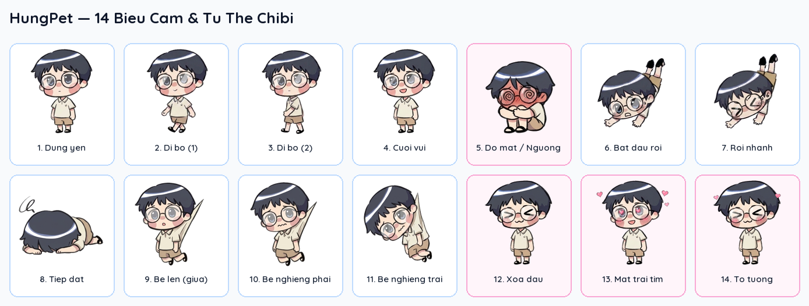
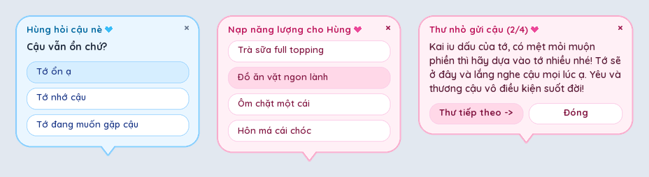

# HungPet — Chibi Desktop Pet (Shimeji-style) dành tặng Kai ♥

Một chú **Desktop Pet (Shimeji-style)** viết bằng Python (`Tkinter` + `Pillow`), chạy nhẹ trên thanh taskbar Windows, được làm riêng để đồng hành, trò chuyện, nhắc uống nước / đi ngủ và gửi những lời nhắn yêu thương mỗi ngày tới người thương của bạn.

> Bạn hoàn toàn có thể `git clone` dự án này về, thay bộ ảnh chibi của chính mình, sửa lại câu thoại / hộp thư bí mật và đóng gói thành file `.exe` độc lập để gửi tặng người ấy!

---

## Xem trước

### 14 biểu cảm & tư thế nhân vật


### Giao diện bong bóng bo tròn (Trò chuyện 3 lựa chọn, Nạp năng lượng, Hộp thư bí mật)


> Xem thêm bản PDF hướng dẫn sử dụng dành cho người nhận tại: [`Hung_Desktop_Pet_Guide.pdf`](Hung_Desktop_Pet_Guide.pdf)

---

## Tính năng chính

- **Nhân vật chibi trong suốt luôn nổi trên taskbar (`-topmost`):** Tự do đi dạo qua lại trên thanh taskbar, hỗ trợ kéo thả bằng chuột trái (có vật lý rơi tự do & tiếp đất).
- **Xoa đầu tương tác:** Di chuột qua lại trên vùng đầu nhiều lần nhân vật sẽ đỏ mặt ngại ngùng và bật bong bóng trái tim (`heart_bubble.png`).
- **Nhấp chuột trái gọn nhẹ (không làm phiền lúc làm việc):** Chạy luân phiên 3 nhịp đơn giản: câu hỏi thăm 1 dòng (`CLICK_MESSAGES`) ➔ **Mắt trái tim nói lời yêu** (`13.png` + hạt tim bay lên) ➔ **Tơ tưởng** (`14.png` + bong bóng đám mây hiện chibi người thương `thought_kai.png`).
- **Trò chuyện tương tác 3 lựa chọn (`InteractiveChatPopup`):** Mở qua menu chuột phải *"Trò chuyện với Hùng"* để chọn 1 trong 3 đáp án mẫu, nhân vật sẽ phản hồi bằng câu trả lời và biểu cảm tương ứng.
- **Nạp năng lượng (`FeedCarePopup`):** Mời nhân vật trà sữa, đồ ăn vặt, ôm hoặc hôn má qua menu chuột phải.
- **Hộp thư bí mật (`LoveNotePopup`):** Lưu giữ nhiều lá thư dài tâm tình trong giao diện bong bóng pastel, bấm chuyển từng lá thư.
- **Tự động nhắc theo thời gian & chu kỳ tự nhiên:**
  - Chào buổi sáng (`05:00 – 11:59` khi mở app).
  - Nhắc mỗi đầu giờ (`05:00 – 23:00`) và nhắc đi ngủ mỗi `30` phút vào ban đêm (`00:00 – 04:59`).
  - Tự thả lời yêu / tơ tưởng khi đứng yên mỗi `1–2 phút` (`1800–3600` khung hình ở `33 ms/khung hình`).
- **Tự khởi động cùng Windows (`HKCU\...\Run`):** Tự động bật ở lần chạy `.exe` đầu tiên (không cần quyền Admin) và có nút bật/tắt bất kỳ lúc nào ngay trong menu chuột phải.
- **Nhúng sẵn font tiếng Việt bo tròn (`Quicksand`):** Hiển thị mượt mà dấu tiếng Việt trên mọi máy Windows.

---

## Cài đặt & Chạy từ mã nguồn (Quick Start)

**Yêu cầu:** Python 3.10+ (Windows, hỗ trợ sẵn `tkinter`).

```powershell
# 1. Tải mã nguồn về máy
git clone https://github.com/Hungnt2507/HungPet.git
cd HungPet

# 2. Cài thư viện phụ thuộc
pip install -r requirements.txt

# 3. Chạy thử ứng dụng
python kai_pet.py
```

---

## Hướng dẫn Tự Cá Nhân Hóa cho người thương của bạn

### 1. Cấu trúc thư mục

```text
HungPet/
├── kai_pet.py                  # Mã nguồn chính toàn bộ ứng dụng Desktop Pet
├── requirements.txt            # Thư viện Python (Pillow, pyinstaller)
├── build_exe.bat               # Script 1-click đóng gói ra dist\HungPet.exe
├── Hung_Desktop_Pet_Guide.pdf  # File PDF hướng dẫn mẫu
├── docs/                       # Ảnh minh họa cho README
└── assets/
    ├── sprites/                # 14 ảnh PNG nền trong suốt (591x591 RGBA)
    ├── effects/                # Hiệu ứng bong bóng tim, đám mây suy nghĩ, hạt tim
    └── fonts/                  # Font chữ .ttf/.otf (mặc định: Quicksand)
```

### 2. Thay hình nhân vật & hiệu ứng (`assets/`)

Thay các file `.png` nền trong suốt (`RGBA`, khuyến nghị kích thước `591x591`, căn chân nhân vật chạm khoảng `y = 578` để đứng khít trên taskbar):

| Đường dẫn file | Trạng thái / Vai trò |
|---|---|
| `assets/sprites/1.png` | Đứng yên bình thường (`idle`) |
| `assets/sprites/2.png`, `3.png` | Hai bước đi bộ hướng sang trái (code tự lật ngang khi đi sang phải) |
| `assets/sprites/4.png` | Cười vui / phản ứng `"happy"` / nhắc ngủ đêm |
| `assets/sprites/5.png` | Đỏ mặt ngồi ôm gối / ngại ngùng (`pet_intense`, `"shy"`) |
| `assets/sprites/6.png`, `7.png` | Bắt đầu rơi & đang rơi nhanh |
| `assets/sprites/8.png` | Tiếp đất |
| `assets/sprites/9.png`, `10.png`, `11.png` | Bị chuột nhấc lên (ở giữa, nghiêng phải, nghiêng trái) |
| `assets/sprites/12.png` | Cười tít mắt khi được xoa đầu (`pet`, `"headpat"`) |
| `assets/sprites/13.png` | Mắt trái tim khi nói lời yêu (`love_talk`, `"love"`) |
| `assets/sprites/14.png` | Biểu cảm mơ màng tơ tưởng (`daydream`, `"daydream"`) |
| `assets/effects/thought_kai.png` | Đám mây suy nghĩ chứa ảnh chibi của người nhận (`180x165`) |
| `assets/effects/heart_bubble.png` | Bong bóng trái tim khi xoa đầu (`224x188`) |
| `assets/effects/heart_fx_0..3.png` | Hạt trái tim nhỏ bay lên (`32x32`) |
| `assets/fonts/*.ttf` | Font chữ (tự động nhận diện file `.ttf`/`.otf`, mặc định ưu tiên `Quicksand`) |

### 3. Sửa lời thoại, tên, kích thước & lịch nhắc trong `kai_pet.py`

Mở file `kai_pet.py` bằng trình soạn thảo bất kỳ và chỉnh các phần sau:

1. **Lời thoại & Hộp thư bí mật:**
   - `CLICK_MESSAGES`: Các câu hỏi thăm 1 dòng khi nhấp chuột trái.
   - `LOVE_MESSAGES`: Các câu tỏ tình khi bật biểu cảm mắt trái tim (`13.png`).
   - `DAYDREAM_MESSAGES`: Các câu khi bật chế độ tơ tưởng (`14.png`).
   - `QA_CONVERSATIONS`: Danh sách câu hỏi và 3 lựa chọn trả lời mẫu (kèm phản ứng `"happy"`, `"love"`, `"daydream"`, `"shy"`, `"headpat"`).
   - `CARE_ITEMS`: Danh sách các món đồ ăn / hành động chăm sóc trong menu *Nạp năng lượng*.
   - `SECRET_LOVE_NOTES`: Nội dung các lá thư dài trong *Hộp thư bí mật*.
2. **Tên nhân vật & Kích thước mặc định:**
   - Trong lớp `CleanSettingsMenu`: đổi chữ `"Hùng"` thành tên nhân vật của bạn và sửa các nhãn menu tương ứng.
   - Trong `KaiDesktopPet.__init__`: sửa `self.pet_size = 145` (Nhỏ) sang `175` (Vừa) hoặc `210` (Lớn), đồng bộ với `size_names` và `order` trong `CleanSettingsMenu`.
3. **Tần suất tự thả thính & lời nhắc theo giờ:**
   - Sửa `self.auto_romance_timer = random.randint(1800, 3600)` (mỗi đơn vị = `33 ms`, `1800–3600` tương đương `1–2 phút`).
   - Sửa giờ và nội dung lời chúc sáng / mỗi tiếng / ban đêm trong `check_startup_greeting()` và `check_time_triggers()`.
4. **Khóa tự khởi động cùng Windows:**
   - Đổi `RUN_VALUE_NAME = "HungDesktopPet"` và `AUTOSTART_OFF_FLAG` ở đầu file nếu muốn chạy song song nhiều Desktop Pet khác nhau trên cùng một máy.

---

## Tự đóng gói ra file `.exe` độc lập

Sau khi chỉnh sửa xong, bạn chỉ cần chạy đúp file **`build_exe.bat`** hoặc gõ lệnh trong PowerShell:

```powershell
python -m pip install --upgrade pillow pyinstaller
python -m PyInstaller --noconfirm --onefile --noconsole --name "HungPet" --add-data "assets;assets" kai_pet.py
```

File thành phẩm hoàn chỉnh (đã nhúng toàn bộ hình ảnh, font chữ và hiệu ứng) sẽ nằm tại `dist\HungPet.exe`.

> **Mẹo khi gửi cho người thương:** Đính kèm file `.exe` lên **GitHub Releases** hoặc nén chung với file hướng dẫn PDF thành `.zip` rồi gửi qua Zalo / Google Drive để không bị Messenger hay Gmail chặn đuôi `.exe`. Nếu Windows hiện cảnh báo SmartScreen lúc mở lần đầu, chỉ cần bấm **More info ➔ Run anyway**.
